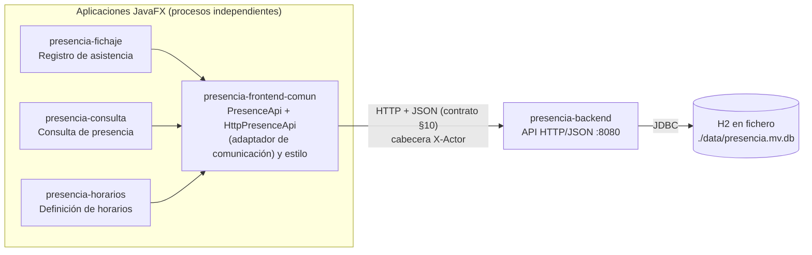
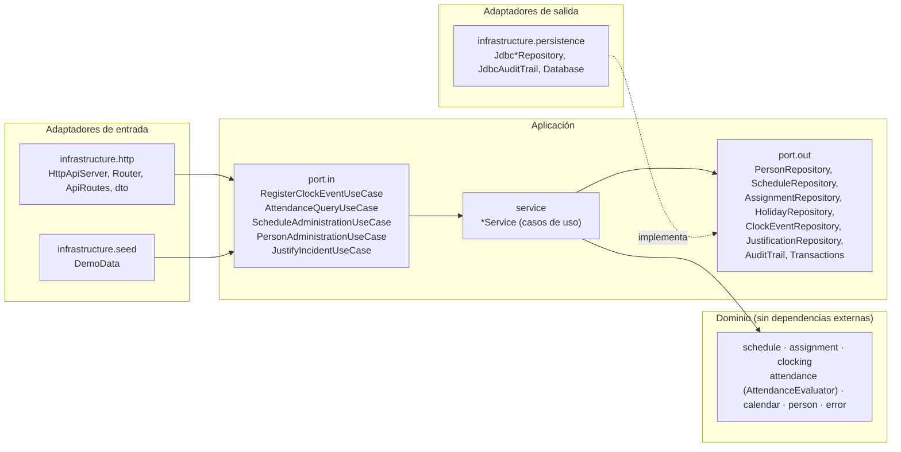
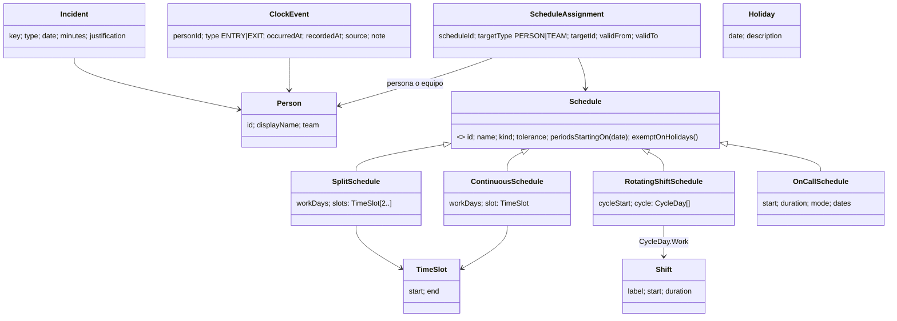
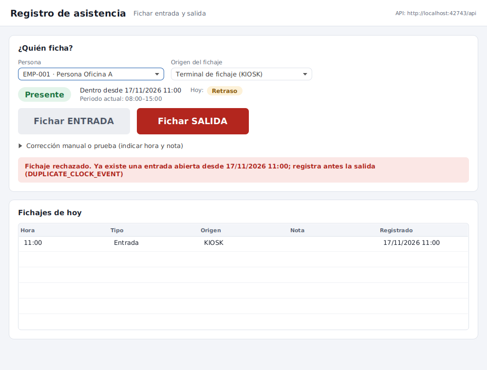
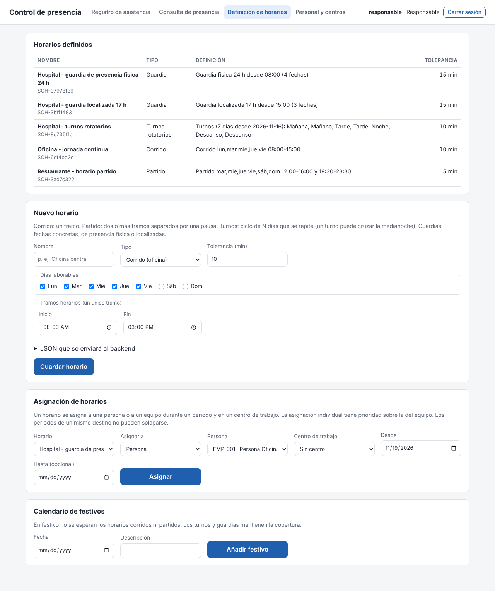

# Control de presencia

Proyecto extraordinario de Ingeniería de Software 2 (EII, ULPGC). Sistema de control de presencia
con un **backend HTTP/JSON** de arquitectura hexagonal, una **base de datos H2** y **tres aplicaciones
JavaFX independientes**: registro de asistencia, consulta de presencia e incidencias, y definición de
horarios.

## Índice

1. [Objetivo](#1-objetivo)
2. [Dependencias y versión de JDK](#2-dependencias-y-versión-de-jdk)
3. [Cómo compilar y ejecutar](#3-cómo-compilar-y-ejecutar)
4. [Arquitectura de sistemas](#4-arquitectura-de-sistemas)
5. [Arquitectura del backend (hexagonal)](#5-arquitectura-del-backend-hexagonal)
6. [Estructura de la entrega y clases principales](#6-estructura-de-la-entrega-y-clases-principales)
7. [Modelo de datos](#7-modelo-de-datos)
8. [Tipos de horario soportados](#8-tipos-de-horario-soportados)
9. [Reglas de cómputo implementadas](#9-reglas-de-cómputo-implementadas)
10. [Contrato de comunicación](#10-contrato-de-comunicación)
11. [Idea propia](#11-idea-propia-incidencias-justificadas-y-calendario-de-festivos)
12. [Capturas](#12-capturas)
13. [Verificación realizada](#13-verificación-realizada)
14. [Límites conocidos](#14-límites-conocidos)

---

## 1. Objetivo

Registrar entradas y salidas de personas, evaluarlas contra el horario que tienen asignado y consultar
el resultado: presencia actual, ausencias, retrasos, salidas anticipadas, salidas pendientes, horas
trabajadas y desviación respecto a lo esperado.

La dificultad está en el dominio: el sistema soporta **horario corrido** (oficina), **horario partido**
(tienda o restaurante), **turnos rotatorios** y **guardias** (hospital, de presencia física o
localizadas), además de festivos e incidencias justificadas.

## 2. Dependencias y versión de JDK

| Herramienta / librería | Versión | Uso |
|---|---|---|
| JDK | **21 o superior** (se compila con `release 21`; funciona también con JDK 25/26) | Lenguaje y servidor HTTP del JDK (`com.sun.net.httpserver`) |
| Maven | 3.9 o superior (IntelliJ IDEA ya lo incluye) | Compilación, pruebas y empaquetado |
| JavaFX (`javafx-controls`) | 21.0.5 | Interfaz de las tres aplicaciones (Maven la descarga; no hay que instalarla) |
| Jackson (`jackson-databind`, `jackson-datatype-jsr310`) | 2.18.1 | JSON del contrato HTTP (backend y cliente de los frontends) |
| H2 Database | 2.3.232 | Base de datos embebida en fichero |
| JUnit Jupiter | 5.11.3 | Pruebas automatizadas |
| TestFX + Monocle | 4.0.18 / 21.0.2 | Pruebas de interfaz JavaFX sin abrir ventanas (solo en pruebas) |

No hacen falta servidores externos: la base de datos se crea sola en `./data/`. Las dependencias de
JavaFX incluyen las librerías nativas del sistema donde se compila (Windows, macOS o Linux).

## 3. Cómo compilar y ejecutar

### Con IntelliJ IDEA

1. *File → Open…* y selecciona la carpeta del repositorio (IntelliJ detecta el `pom.xml` multimódulo).
2. *File → Project Structure → Project SDK*: un JDK 21 o superior.
3. En el desplegable de ejecución aparecen las configuraciones compartidas de la carpeta `.run/`:
   - **Sistema completo**: arranca el backend y las tres aplicaciones a la vez (las apps esperan
     unos segundos a que el backend esté escuchando).
   - **Backend** (`software.ulpgc.presencia.BackendApplication`).
   - **App Fichaje**, **App Consulta** y **App Horarios** (`…frontend.<app>.<App>Launcher`).
   - **Todas las pruebas**: `mvn test` de todos los módulos.

Las configuraciones usan `$PROJECT_DIR$` como directorio de trabajo, por lo que la base de datos se
crea en `<repositorio>/data/` (excluida de Git). Cada aplicación tiene una clase `…Launcher` que no
extiende `Application`, así se ejecuta desde el classpath sin configurar el *module-path* de JavaFX.

### Desde la terminal

No hace falta instalar Maven: el repositorio incluye el **Maven Wrapper** (`mvnw` / `mvnw.cmd`), que
descarga Maven 3.9.11 la primera vez. Solo se necesita un JDK 21+ con `JAVA_HOME` configurado.

En Windows (PowerShell):

```powershell
.\mvnw.cmd clean package
```

En Linux o macOS:

```bash
./mvnw clean package
```

(Si Maven está instalado, `mvn clean package` es equivalente.) El empaquetado compila y ejecuta las 64 pruebas (las de interfaz se ejecutan sin ventanas) y
genera un jar ejecutable por proceso. Cada uno se lanza en una terminal distinta:

```bash
java -jar backend/target/presencia-backend-app.jar
```

```bash
java -jar frontend/fichaje/target/presencia-fichaje-app.jar
```

```bash
java -jar frontend/consulta/target/presencia-consulta-app.jar
```

```bash
java -jar frontend/horarios/target/presencia-horarios-app.jar
```

El backend se ejecuta de forma independiente (se puede usar la API con `curl`). Sin empaquetar también
vale `mvn -pl backend compile exec:java` y, para cada aplicación, `mvn -pl frontend/fichaje javafx:run`
(después de un `mvn install -DskipTests`).

| Proceso | Dirección |
|---|---|
| Backend (API HTTP/JSON) | <http://localhost:8080/api/health> |
| Registro de asistencia | aplicación JavaFX `presencia-fichaje` |
| Consulta de presencia e incidencias | aplicación JavaFX `presencia-consulta` |
| Definición de horarios | aplicación JavaFX `presencia-horarios` |

### Configuración: puertos, base de datos y datos iniciales

Los valores por defecto del backend están en `backend/src/main/resources/application.properties`;
la URL de la API de las aplicaciones está en `ApiConfig` (por defecto `http://localhost:8080/api`). Cada clave se puede sobrescribir con `-Dclave=valor`
o con una variable de entorno (mayúsculas y `_`), sin tocar el código ni usar rutas absolutas:

| Clave | Variable de entorno | Por defecto | Descripción |
|---|---|---|---|
| `presencia.http.host` | `PRESENCIA_HTTP_HOST` | `localhost` | Interfaz del backend |
| `presencia.http.port` | `PRESENCIA_HTTP_PORT` | `8080` | Puerto del backend |
| `presencia.cors.allowed-origin` | `PRESENCIA_CORS_ALLOWED_ORIGIN` | `*` | Origen permitido por CORS |
| `presencia.db.url` | `PRESENCIA_DB_URL` | `jdbc:h2:file:./data/presencia;DB_CLOSE_DELAY=-1` | Base de datos (relativa al directorio de trabajo) |
| `presencia.db.user` / `presencia.db.password` | `PRESENCIA_DB_USER` / `PRESENCIA_DB_PASSWORD` | `sa` / vacío | Credenciales de la BD local de desarrollo |
| `presencia.zone` | `PRESENCIA_ZONE` | `Atlantic/Canary` | Zona horaria de los horarios |
| `presencia.seed` | `PRESENCIA_SEED` | `true` | Cargar datos de ejemplo si la BD está vacía |
| `presencia.api.url` | `PRESENCIA_API_URL` | `http://localhost:8080/api` | URL de la API que usan las tres aplicaciones |

Ejemplo: `java -Dpresencia.http.port=9090 -jar backend/target/presencia-backend-app.jar` y
`java -Dpresencia.api.url=http://localhost:9090/api -jar frontend/fichaje/target/presencia-fichaje-app.jar`.

Para **empezar de cero** basta con borrar la carpeta `data/` con el backend parado.

**Datos iniciales** (todos ficticios, cargados a través de los casos de uso y con fechas relativas al
día de arranque para que la demostración funcione cualquier día):

| Persona | Equipo | Horario | Situación de ejemplo |
|---|---|---|---|
| EMP-001 Persona Oficina A | administracion | Oficina (asignado **al equipo**) | Fichajes puntuales |
| EMP-002 Persona Oficina B | administracion | Oficina (asignado al equipo) | Llega 27 min tarde el último día laborable |
| EMP-003 Persona Restaurante | sala | Restaurante (partido) | Sale 45 min antes en el último tramo |
| EMP-004 Persona Enfermería | planta-3 | Turnos rotatorios | **Olvidó fichar la salida** en su último turno |
| EMP-005 Persona Medicina A | urgencias | Guardia de presencia física 24 h | Abandona la guardia 2 h antes |
| EMP-006 Persona Medicina B | urgencias | Guardia localizada 17 h | Sin fichajes (no se exigen) |
| EMP-007 Persona Sin Horario | — | — | Para probar `SCHEDULE_NOT_ASSIGNED` |
| EMP-008 Persona Contrato Finalizado | — | Oficina hasta hace 31 días | Para probar `DATE_OUT_OF_PERIOD` |

También se cargan cuatro festivos del calendario y la historia de los últimos seis días.

## 4. Arquitectura de sistemas



- **Tres aplicaciones frontend diferenciadas**: cada una es un módulo Maven y un proceso propio con su
  ventana, su `Launcher` y su jar ejecutable. No comparten estado; solo comparten el módulo
  `presencia-frontend-comun`.
- **Los frontends nunca acceden a la base de datos**: solo usan la interfaz `PresenceApi`
  (`frontend/comun/.../api/PresenceApi.java`). Su implementación `HttpPresenceApi` es el adaptador de
  comunicación (cliente HTTP del JDK + Jackson); las vistas la reciben por constructor, por lo que se
  puede sustituir (otra URL, un doble de prueba, otro protocolo) sin tocarlas. Los tipos del contrato
  (`ApiModel`) son propios del frontend: no se reutilizan clases del backend.
- **Las vistas no bloquean la interfaz**: todas las llamadas se hacen en segundo plano (`Background`)
  y el resultado se muestra en el hilo de JavaFX.
- **El backend no depende de los frontends**: es ejecutable de forma independiente y solo expone JSON.
  (Las aplicaciones dependen del backend únicamente en sus pruebas, para probar contra el sistema real.)
- **Base de datos**: H2 embebida en un fichero local; el esquema (`backend/src/main/resources/db/schema.sql`)
  se crea al arrancar.

## 5. Arquitectura del backend (hexagonal)



Reglas de dependencia (comprobadas por `ArchitectureTest`):

- `domain` solo usa el JDK: no importa nada de `application`, `infrastructure`, Jackson, H2, JDBC ni HTTP.
- `application` solo depende de `domain` y de sus propios puertos.
- Los adaptadores HTTP y de persistencia no se conocen entre sí.
- `Backend` es la **raíz de composición**: el único sitio que instancia implementaciones concretas.

Los casos de uso se han probado también con **adaptadores en memoria**
(`backend/src/test/.../support/InMemoryAdapters.java`), lo que demuestra que los puertos de salida son
sustituibles.

## 6. Estructura de la entrega y clases principales

```
control-presencia/
├── pom.xml                         POM padre (módulos backend y frontend, JDK 21)
├── .run/                           Configuraciones de ejecución de IntelliJ
├── backend/                        presencia-backend
│   └── src/main/java/software/ulpgc/presencia/
│       ├── BackendApplication.java Punto de entrada
│       ├── Backend.java            Raíz de composición
│       ├── domain/                 Modelo y reglas (sin dependencias)
│       ├── application/
│       │   ├── port/in/            Casos de uso (interfaces y comandos)
│       │   ├── port/out/           Puertos de salida
│       │   └── service/            Implementación de los casos de uso
│       └── infrastructure/
│           ├── http/               Adaptador HTTP (servidor, rutas, DTO, errores)
│           ├── persistence/        Adaptador JDBC/H2
│           ├── json/               Representación JSON de horarios
│           ├── config/             AppConfig
│           └── seed/               Datos de ejemplo
├── frontend/                       presencia-frontend (agregador)
│   ├── comun/                      presencia-frontend-comun
│   │   ├── .../frontend/api/       PresenceApi, HttpPresenceApi, ApiModel, ApiException, ApiConfig
│   │   └── .../frontend/ui/        Ui, Badge, MessageBar, Texts, Background, presencia.css
│   ├── fichaje/                    presencia-fichaje   (FichajeLauncher, FichajeApp, FichajeView)
│   ├── consulta/                   presencia-consulta  (ConsultaLauncher, ConsultaApp, ConsultaView)
│   └── horarios/                   presencia-horarios  (HorariosLauncher, HorariosApp, HorariosView, ScheduleForm)
└── docs/capturas/                  Capturas de las tres aplicaciones
```

| Clase | Responsabilidad |
|---|---|
| `Schedule` (interfaz sellada) y `ContinuousSchedule`, `SplitSchedule`, `RotatingShiftSchedule`, `OnCallSchedule` | Cada tipo de horario y sus reglas: qué periodos de trabajo empiezan cada día |
| `ScheduleAssignment`, `ScheduleAssignments` | Asignación a persona o equipo en un periodo; la individual prevalece |
| `ClockEvent`, `ClockingPolicy`, `WorkSession` | Fichaje inmutable, coherencia de la secuencia y emparejado entrada-salida |
| `AttendanceEvaluator` | Servicio de dominio: incidencias, horas, desviación, estado diario y presencia actual |
| `RegisterClockEventService` | Caso de uso fichar (cerrojo por persona, validación, auditoría) |
| `AttendanceQueryService` | Presencia actual, informes, fichajes, incidencias y auditoría |
| `ScheduleAdministrationService` | Alta de horarios, asignaciones (sin solapes) y festivos |
| `IncidentJustificationService` | Justificación de incidencias (idea propia) |
| `HttpApiServer`, `Router`, `ApiRoutes` | Adaptador HTTP y traducción de errores de dominio a códigos HTTP |
| `Database`, `Jdbc*Repository`, `JdbcAuditTrail` | Persistencia JDBC con transacciones |
| `PresenceApi` / `HttpPresenceApi` | Puerto de comunicación de los frontends y su adaptador HTTP + JSON |
| `FichajeView`, `ConsultaView`, `HorariosView`, `ScheduleForm` | Vistas JavaFX de cada aplicación (reciben `PresenceApi` y `Clock` por constructor) |
| `Ui`, `Badge`, `MessageBar`, `Background` | Componentes visuales comunes, mensajes de error del contrato y llamadas en segundo plano |

## 7. Modelo de datos

**Dominio**



Las **incidencias se calculan** (no se guardan) a partir de fichajes, horario, festivos y la hora
actual; así nunca quedan desfasadas si se corrige un fichaje. Su clave estable
(`persona|fecha|tipo|hora`, p. ej. `EMP-002|2026-11-16|LATE_ARRIVAL|08:00`) permite guardar su justificación.

**Tablas** (`schema.sql`)

| Tabla | Contenido |
|---|---|
| `person` | id, display_name, team |
| `schedule` | id, name, kind, tolerance_minutes y `definition` (JSON con la estructura propia de cada tipo) |
| `schedule_assignment` | schedule_id, target_type (PERSON/TEAM), target_id, valid_from, valid_to |
| `holiday` | holiday_date, description |
| `clock_event` | person_id, event_type, occurred_at, recorded_at, source, note — **solo se inserta** |
| `incident_justification` | incident_key, person_id, reason, justified_by, justified_at |
| `audit_log` | logged_at, actor, action, entity_type, entity_id, detail — cada modificación |

Los instantes se guardan en UTC (`TIMESTAMP WITH TIME ZONE`) y se devuelven en la zona configurada.
Cada operación de escritura y su entrada de auditoría se guardan en la **misma transacción**.

## 8. Tipos de horario soportados

Cada tipo es una clase con reglas explícitas. El JSON mostrado es el cuerpo de `POST /api/schedules`.

### Corrido — oficina con jornada continua

Un único tramo los días laborables. En festivo no se trabaja.

```json
{ "name": "Oficina - jornada continua", "kind": "CONTINUOUS", "toleranceMinutes": 10,
  "workDays": ["MONDAY","TUESDAY","WEDNESDAY","THURSDAY","FRIDAY"],
  "slots": [ { "start": "08:00", "end": "15:00" } ] }
```

### Partido — restaurante con mañana y tarde

Dos o más tramos el mismo día **separados por una pausa** (se rechazan tramos contiguos o solapados).
Cada tramo se evalúa por separado: se puede llegar tarde al segundo o no volver tras la pausa.

```json
{ "name": "Restaurante - horario partido", "kind": "SPLIT", "toleranceMinutes": 5,
  "workDays": ["TUESDAY","WEDNESDAY","THURSDAY","FRIDAY","SATURDAY","SUNDAY"],
  "slots": [ { "start": "12:00", "end": "16:00" }, { "start": "19:30", "end": "23:30" } ] }
```

### Turnos rotatorios — hospital

Un ciclo de N días que se repite desde `cycleStart` (día del ciclo = (fecha − inicio) mod N). Un turno
puede **cruzar la medianoche** y pertenece al día en que empieza. Se rechaza un ciclo en el que un turno
se solape con el del día siguiente. Los festivos no anulan los turnos (cobertura continua).

```json
{ "name": "Hospital - turnos rotatorios", "kind": "ROTATING_SHIFT", "toleranceMinutes": 10,
  "cycleStart": "2026-11-16",
  "cycle": [ { "label": "Mañana", "start": "07:00", "durationMinutes": 480 },
             { "label": "Mañana", "start": "07:00", "durationMinutes": 480 },
             { "label": "Tarde",  "start": "15:00", "durationMinutes": 420 },
             { "label": "Tarde",  "start": "15:00", "durationMinutes": 420 },
             { "label": "Noche",  "start": "22:00", "durationMinutes": 600 },
             { "rest": true }, { "rest": true } ] }
```

### Guardias — hospital

Guardias en fechas concretas, hasta 24 h. Dos modalidades con reglas distintas:

- `PHYSICAL` (presencia física): se exige fichar; se evalúan ausencia, retraso y salida anticipada.
- `LOCALIZED` (localizada): no se exige presencia, no genera ausencias; si se acude, el tiempo fichado
  computa como trabajado (activación).

```json
{ "name": "Hospital - guardia de presencia física 24 h", "kind": "ON_CALL", "toleranceMinutes": 15,
  "start": "08:00", "durationMinutes": 1440, "mode": "PHYSICAL",
  "dates": ["2026-11-11", "2026-11-15", "2026-11-19"] }
```

## 9. Reglas de cómputo implementadas

Encapsuladas en `ClockingPolicy` (al fichar) y `AttendanceEvaluator` (al consultar):

**Al fichar**
1. La persona debe existir (`PERSON_NOT_FOUND`).
2. Entrada y salida se alternan: una segunda entrada sin salida es `DUPLICATE_CLOCK_EVENT`; una salida
   sin entrada abierta es `INCONSISTENT_CLOCK_EVENT`.
3. Los fichajes se añaden en orden cronológico (no se puede insertar uno anterior al último) y no
   pueden estar en el futuro.
4. Una **entrada** exige un horario vigente ese día: sin ninguna asignación → `SCHEDULE_NOT_ASSIGNED`;
   con asignaciones, pero ninguna cubre la fecha → `DATE_OUT_OF_PERIOD`. La salida no lo exige (cierra
   la entrada abierta, aunque sea de un turno de noche).
5. Se puede indicar la hora del fichaje (corrección de un olvido, origen `ADMIN`); queda guardada
   también la hora real de registro (`recordedAt`) y se audita.

**Al evaluar**
1. Los fichajes se emparejan en sesiones y cada sesión se asocia al periodo esperado con el que más se
   solapa (también del día anterior o siguiente, para turnos de noche y guardias). Una entrada hasta 2 h
   antes del inicio se asocia a ese periodo.
2. Sobre cada periodo ya iniciado, con la tolerancia del horario:
   - **Ausencia**: ninguna entrada pasada la tolerancia.
   - **Retraso**: primera entrada posterior a inicio + tolerancia.
   - **Salida anticipada**: última salida anterior a fin − tolerancia (solo cuando el periodo terminó).
   - **Salida pendiente**: entrada abierta pasado fin + tolerancia.
   - **Fuera de horario**: sesión que no corresponde a ningún periodo (informativo).
3. Las horas trabajadas solo cuentan sesiones **cerradas**; la desviación (trabajado − esperado) solo se
   calcula para días terminados.
4. Estado diario (el más grave): Ausente > Salida pendiente > Retraso > Salida anticipada > Justificado
   > En curso / Pendiente / Cumplido / Descanso / Festivo / Sin horario.
5. Asignaciones: la individual prevalece sobre la del equipo; las de un mismo destino no se solapan.

## 10. Contrato de comunicación

HTTP + JSON, prefijo `/api`, UTF-8. Las fechas son `AAAA-MM-DD`, las horas `HH:mm` y los instantes
ISO-8601 con desplazamiento (`2026-11-17T08:05:00Z`). La cabecera opcional **`X-Actor`** identifica
quién hace la operación para la auditoría (las aplicaciones envían `app-fichaje`, `app-consulta` y
`app-horarios`). Los `POST` exigen `Content-Type: application/json` y se rechazan campos desconocidos.

| Método | Ruta | Cuerpo / parámetros | Respuesta |
|---|---|---|---|
| GET | `/api/health` | — | Estado, zona, hora del servidor y valores de los enumerados |
| GET | `/api/people` | — | `[Person]` |
| POST | `/api/people` | `{"id":"EMP-009","displayName":"…","team":"…"}` | 201 `Person` |
| GET | `/api/schedules` | — | `[Schedule]` (§8, con `id` y `summary`) |
| GET | `/api/schedules/{id}` | — | `Schedule` |
| POST | `/api/schedules` | Uno de los cuerpos del §8 | 201 `Schedule` |
| GET | `/api/assignments` | `?personId=` opcional | `[Assignment]` |
| POST | `/api/assignments` | `{"scheduleId","personId" o "team","validFrom","validTo"?}` | 201 `Assignment` |
| GET | `/api/holidays` | — | `[{"date","description"}]` |
| POST | `/api/holidays` | `{"date":"2026-12-25","description":"Navidad"}` | 201 |
| POST | `/api/clock-events` | `{"personId","type":"ENTRY"\|"EXIT","source":"KIOSK"\|"WEB"\|"ADMIN"\|"IMPORT","timestamp"?,"note"?}` | 201 `{"event": ClockEvent, "presence": Presence}` |
| GET | `/api/clock-events` | `?personId=&from=&to=` (por defecto hoy) | `[ClockEvent]` |
| GET | `/api/presence` | — | `[Presence]` de todas las personas |
| GET | `/api/presence/{personId}` | — | `Presence` |
| GET | `/api/reports/daily` | `?personId=&from=&to=` (máx. 366 días) | `Report` con totales y días |
| GET | `/api/incidents` | `?personId=&from=&to=&type=` (por defecto últimos 7 días) | `[Incident]` |
| POST | `/api/incidents/justifications` | `{"incidentKey","reason"}` | 201 `Justification` |
| GET | `/api/audit` | `?limit=` (1–500, por defecto 50) | `[AuditEntry]` más recientes primero |

Ejemplo de fichaje y su respuesta:

```http
POST /api/clock-events
Content-Type: application/json
X-Actor: app-fichaje

{"personId":"EMP-001","type":"ENTRY","source":"KIOSK"}
```

```json
{ "event": { "id": "59ce…", "personId": "EMP-001", "type": "ENTRY", "occurredAt": "2026-11-17T08:25:00Z",
             "recordedAt": "2026-11-17T08:25:00Z", "source": "KIOSK", "note": null },
  "presence": { "personId": "EMP-001", "displayName": "Persona Oficina A", "status": "PRESENT", "inside": true,
                "since": "2026-11-17T08:25:00Z", "currentPeriod": "08:00-15:00",
                "currentPeriodStart": "2026-11-17T08:00:00Z", "currentPeriodEnd": "2026-11-17T15:00:00Z",
                "todayStatus": "LATE" } }
```

Un día del informe (`GET /api/reports/daily`) contiene `date`, `scheduleName`, `holiday`, `status`,
`expectedMinutes`, `workedMinutes`, `deviationMinutes` (null si el día no ha terminado), `openSession`,
`periods` (esperado y fichado de cada periodo) e `incidents`.

Estados de presencia (`status`): `PRESENT`, `PRESENT_OUT_OF_SCHEDULE`, `CHECKOUT_PENDING`, `ABSENT`,
`EXPECTED`, `ON_CALL`, `OFF_DUTY`, `NO_SCHEDULE`. Estados diarios: `NO_SCHEDULE`, `HOLIDAY`, `REST`,
`PENDING`, `IN_PROGRESS`, `COMPLETED`, `EXTRA_WORK`, `JUSTIFIED`, `EARLY_DEPARTURE`, `LATE`,
`CHECKOUT_PENDING`, `ABSENT`. Tipos de incidencia: `ABSENCE`, `LATE_ARRIVAL`, `EARLY_DEPARTURE`,
`MISSING_CHECKOUT`, `UNSCHEDULED_WORK`.

### Errores

Todos los errores tienen el mismo cuerpo:

```json
{ "error": "DUPLICATE_CLOCK_EVENT", "message": "Ya existe una entrada abierta desde 17/11/2026 08:25; registra antes la salida", "status": 409 }
```

| HTTP | `error` | Cuándo |
|---|---|---|
| 400 | `INVALID_DATA` | Datos incompletos o mal formados, JSON roto, campo desconocido, rango de fechas inválido, tramos incoherentes… |
| 404 | `PERSON_NOT_FOUND`, `SCHEDULE_NOT_FOUND`, `INCIDENT_NOT_FOUND`, `NOT_FOUND` | Persona, horario, incidencia o ruta inexistente |
| 405 | `METHOD_NOT_ALLOWED` | Método no admitido en la ruta |
| 409 | `DUPLICATE_CLOCK_EVENT` | Entrada con otra entrada abierta |
| 409 | `INCONSISTENT_CLOCK_EVENT` | Salida sin entrada previa, o fichaje anterior al último |
| 409 | `PERSON_ALREADY_EXISTS`, `HOLIDAY_ALREADY_EXISTS`, `ASSIGNMENT_OVERLAP`, `INCIDENT_ALREADY_JUSTIFIED` | Conflictos de alta |
| 413 | `PAYLOAD_TOO_LARGE` | Cuerpo de más de 64 KB |
| 415 | `UNSUPPORTED_MEDIA_TYPE` | `POST` sin `application/json` |
| 422 | `SCHEDULE_NOT_ASSIGNED` | La persona no tiene ningún horario asignado |
| 422 | `DATE_OUT_OF_PERIOD` | La fecha está fuera de los periodos de sus asignaciones |
| 500 | `INTERNAL_ERROR` | Error no controlado (sin detalles internos; se registra en el log) |

## 11. Idea propia: incidencias justificadas y calendario de festivos

**Incidencias justificadas.** Desde *Consulta → Incidencias* se puede justificar una ausencia, un
retraso o una salida (cita médica, formación, atasco…). La justificación guarda motivo, autor y fecha,
queda en la auditoría, no se puede repetir, y el día pasa a estado *Justificado* sin perder la
incidencia original. Encaja con el dominio porque un control de presencia real no se limita a detectar
desviaciones: necesita registrar por qué ocurrieron, y hacerlo sin modificar los fichajes (que siguen
siendo de solo añadir) mantiene la trazabilidad.

**Calendario de festivos con reglas por tipo de horario.** Un festivo anula los periodos de los horarios
corridos y partidos (la oficina y la tienda cierran), pero **no** los turnos ni las guardias, porque un
hospital mantiene la cobertura. Es una regla explícita de cada tipo (`Schedule.exemptOnHolidays()`).

Además, se registra la **auditoría** de todas las modificaciones (consultable en *Consulta → Auditoría*)
y se permite la **corrección de olvidos** con un fichaje de origen `ADMIN` con hora indicada.

## 12. Capturas

Generadas a partir de las aplicaciones JavaFX reales conectadas al backend real (con los datos de
ejemplo y un reloj fijo en el martes 17/11/2026 a las 11:00) por las pruebas de interfaz:

```bash
mvn install -DskipTests
```

```bash
mvn -pl frontend/fichaje,frontend/consulta,frontend/horarios test -Dcapturas.dir=$(pwd)/docs/capturas
```

### Registro de asistencia

Entrada registrada: el estado pasa a *Presente* y el día se marca como *Retraso*.


Segundo intento de entrada: rechazado con `DUPLICATE_CLOCK_EVENT`.



### Consulta de presencia e incidencias

Presencia actual de todas las personas (EMP-004 aparece con *Salida pendiente* porque no fichó la salida ayer).


Informe por persona y periodo: esperado, trabajado, desviación e incidencias de cada día.


Incidencias de todas las personas, con una ya justificada desde la propia tabla.


Auditoría de modificaciones.


### Definición de horarios

Horarios definidos de los cuatro tipos y formulario de un horario corrido.



Formulario de turnos rotatorios (ciclo de días de trabajo y descanso).


## 13. Verificación realizada

### Pruebas automatizadas (`mvn test`: 64 pruebas, todas correctas)

| Clase de prueba | Qué verifica |
|---|---|
| `ScheduleTypesTest` (7) | Periodos de cada tipo de horario, ciclos antes de su inicio, validaciones (tramos sin pausa, solapes de turnos, tolerancia) |
| `ClockingPolicyTest` (4) | Entrada duplicada, salida sin entrada, orden cronológico y fichajes futuros |
| `AttendanceEvaluatorTest` (20) | Puntualidad, retraso, salida anticipada, ausencia, salida pendiente, festivos, trabajo extra, horario partido por tramos, turno de noche que cruza la medianoche, guardias física y localizada, justificaciones, estados de presencia |
| `UseCasesTest` (9) | Casos de uso con **adaptadores en memoria**: flujo completo, todos los errores de fichaje, prioridad persona/equipo, solapes de asignaciones, festivos, justificación única y auditoría |
| `HttpApiIntegrationTest` (6) | Backend real (HTTP + H2 en fichero temporal): flujo de fichaje y consulta, **todos los códigos de error del contrato**, ida y vuelta de los 4 tipos de horario, **persistencia tras reiniciar**, carga única de datos iniciales y CORS |
| `ArchitectureTest` (3) | Reglas de dependencia de la arquitectura hexagonal |
| `HttpPresenceApiContractTest` (5) | **Contrato frontend/backend**: el cliente de las aplicaciones contra el backend real (lectura, altas de los 4 tipos de horario, fichaje, justificación, códigos de error y backend caído) |
| `FichajeViewTest` (3) | **Interfaz** de fichaje contra el backend real: entrada, duplicado, salida, `SCHEDULE_NOT_ASSIGNED`, `DATE_OUT_OF_PERIOD`, salida sin entrada y corrección manual de un olvido |
| `ConsultaViewTest` (4) | **Interfaz** de consulta: presencia actual, informe por persona y periodo, filtro y justificación de incidencias, auditoría y fichajes por periodo |
| `HorariosViewTest` (3) | **Interfaz** de horarios: alta de los cuatro tipos desde el formulario, validación de horas, personas, asignación a equipo, solape y festivos duplicados |

Las pruebas de interfaz usan TestFX con Monocle (*headless*), así que no abren ventanas y se pueden
ejecutar en cualquier equipo o en integración continua.

### Comprobaciones manuales (sistema completo desde una copia limpia)

Realizadas con `mvn clean package`, el jar del backend y los tres jars de las aplicaciones:

| Comprobación | Resultado |
|---|---|
| Compila y pasan las pruebas desde un `git clone` limpio | ✔ |
| El backend y las tres aplicaciones arrancan con `java -jar` y se comunican | ✔ |
| Las apps esperan al backend si se arrancan a la vez (configuración *Sistema completo*) | ✔ cargan los datos al estar disponible |
| Se cargan los tres tipos de horario de ejemplo (más la guardia localizada) | ✔ 5 horarios |
| Horarios asignados a personas ficticias (individual y por equipo) | ✔ |
| Entrada y salida correctas | ✔ |
| Retraso (EMP-001 ficha tarde) y cómo aparece en la consulta | ✔ *Retraso* en presencia, informe e incidencias |
| Salida anticipada (EMP-003, EMP-005) y salida pendiente (EMP-004) | ✔ |
| Consulta por persona y por periodo | ✔ |
| Persona inexistente | ✔ 404 `PERSON_NOT_FOUND` |
| Fichaje duplicado | ✔ 409 `DUPLICATE_CLOCK_EVENT` (captura) |
| Salida sin entrada previa | ✔ 409 `INCONSISTENT_CLOCK_EVENT` |
| Horario no asignado (EMP-007) | ✔ 422 `SCHEDULE_NOT_ASSIGNED` |
| Fecha fuera de periodo (EMP-008) | ✔ 422 `DATE_OUT_OF_PERIOD` |
| Datos incompletos / JSON incorrecto | ✔ 400 `INVALID_DATA` |
| Guardia sin fechas desde el formulario | ✔ rechazada con mensaje |
| Corrección de olvido: salida `ADMIN` con hora de ayer para EMP-004 | ✔ aceptada; `recordedAt` conserva la hora real |
| Reinicio del backend: fichajes, horarios y auditoría persisten | ✔ |

Para repetirlas a mano con `curl`:

```bash
curl -s -X POST localhost:8080/api/clock-events -H 'Content-Type: application/json' -d '{"personId":"EMP-007","type":"ENTRY","source":"KIOSK"}'
```

## 14. Límites conocidos

- **Seguridad y permisos**: no hay autenticación ni roles; cualquiera con acceso a la API puede fichar
  por otra persona o definir horarios. `X-Actor` es declarativo (no verificado). Por eso el backend
  escucha por defecto solo en `localhost`. Un despliegue real necesitaría autenticación (p. ej. OIDC),
  roles empleado/responsable y HTTPS.
- **Concurrencia**: los fichajes de una misma persona se serializan con un cerrojo en memoria y las
  escrituras van en transacciones. Es correcto con **una sola instancia** del backend; varias instancias
  requerirían un bloqueo en base de datos.
- **Reglas de cómputo**: una entrada abierta no suma horas hasta que se ficha la salida; no hay pausas
  dentro de un tramo, horas extra con compensación, convenios, bolsa de horas ni cómputo semanal/anual.
  Los tramos de horarios corridos y partidos no cruzan la medianoche (para eso están turnos y guardias).
  Las guardias tienen como máximo 24 h.
- **Incidencias**: se recalculan en cada consulta; si se cambian asignaciones pasadas, las incidencias
  de esos días cambian (los fichajes y las justificaciones no). Una justificación no se puede deshacer.
- **Modificación de datos**: no hay edición ni borrado de horarios, asignaciones o personas (solo altas),
  ni corrección/anulación de fichajes más allá de añadir uno nuevo con hora indicada; un fichaje no
  puede ser anterior al último registrado.
- **Zona horaria**: se usa una sola zona configurable para todos los centros. Las aplicaciones
  calculan "hoy" con el reloj del equipo donde se ejecutan.
- **Aplicaciones JavaFX**: no hay navegación entre las tres aplicaciones (son procesos separados) ni
  actualización en tiempo real salvo la presencia actual (cada 30 s). Al ejecutarlas desde el
  classpath JavaFX muestra el aviso `Unsupported JavaFX configuration: classes were loaded from
  'unnamed module'`, que es inofensivo. El backend mantiene CORS por si se añade un cliente web.
- **Escalabilidad**: las consultas cargan los datos de la persona y evalúan en memoria (adecuado para
  cientos de personas, no para miles con rangos largos); el rango de consulta está limitado a 366 días.
- **Datos**: todos los datos de ejemplo son ficticios. La base de datos se genera localmente en `data/`
  y está excluida del repositorio.
