# Control de presencia

Proyecto extraordinario de Ingeniería de Software 2 (EII, ULPGC). Sistema de control de presencia
formado por un **backend HTTP/JSON** de arquitectura hexagonal (el *broker* que responde a todas las
peticiones), una **base de datos H2** y una **aplicación web única con inicio de sesión**: según quién
entre, se muestra el perfil de **responsable** (personal, centros de trabajo, horarios, consultas y
correcciones) o de **empleado** (su horario, fichar entrada y salida y sus registros). La aplicación
está dividida en **módulos frontend independientes**: registro de asistencia, consulta de presencia e
incidencias, definición de horarios, y personal y centros.

## Índice

1. [Objetivo](#1-objetivo)
2. [Dependencias y versión de JDK](#2-dependencias-y-versión-de-jdk)
3. [Cómo compilar y ejecutar](#3-cómo-compilar-y-ejecutar)
4. [Arquitectura de sistemas](#4-arquitectura-de-sistemas)
5. [Arquitectura del backend (hexagonal)](#5-arquitectura-del-backend-hexagonal)
6. [Estructura de la entrega y clases principales](#6-estructura-de-la-entrega-y-clases-principales)
7. [Modelo de datos](#7-modelo-de-datos)
8. [Tipos de horario soportados](#8-tipos-de-horario-soportados)
9. [Reglas de cómputo implementadas](#9-reglas-de-cómputo-implementadas)
10. [Contrato de comunicación](#10-contrato-de-comunicación)
11. [Ideas propias](#11-ideas-propias)
12. [Capturas](#12-capturas)
13. [Verificación realizada](#13-verificación-realizada)
14. [Límites conocidos](#14-límites-conocidos)

---

## 1. Objetivo

Registrar entradas y salidas de personas, evaluarlas contra el horario que tienen asignado y consultar
el resultado: presencia actual, ausencias, retrasos, salidas anticipadas, salidas pendientes, horas
trabajadas y desviación respecto a lo esperado.

La dificultad está en el dominio: el sistema soporta **horario corrido** (oficina), **horario partido**
(tienda o restaurante), **turnos rotatorios** y **guardias** (hospital, de presencia física o
localizadas), además de festivos e incidencias justificadas.

## 2. Dependencias y versión de JDK

| Herramienta / librería | Versión | Uso |
|---|---|---|
| JDK | **21 o superior** (se compila con `release 21`; funciona también con JDK 25/26) | Lenguaje y servidores HTTP del JDK (`com.sun.net.httpserver`) |
| Maven | 3.9 (incluido con el **Maven Wrapper** `mvnw`/`mvnw.cmd`; no hay que instalarlo) | Compilación, pruebas y empaquetado |
| Jackson (`jackson-databind`, `jackson-datatype-jsr310`) | 2.18.1 | JSON del contrato HTTP |
| H2 Database | 2.3.232 | Base de datos embebida en fichero |
| JUnit Jupiter | 5.11.3 | Pruebas automatizadas |
| Navegador web | cualquiera actual | Aplicación (HTML + JavaScript con módulos ES, sin librerías ni compilación) |

Opcional: Node.js + Playwright, solo para el recorrido automático con navegador (`docs/e2e/recorrido.cjs`).

## 3. Cómo compilar y ejecutar

El sistema son **dos procesos independientes**: el **backend** (API HTTP/JSON en el puerto 8080) y la
**aplicación web** (puerto 8081). Primero se arranca el backend y después la web; luego se abre
<http://localhost:8081/> en el navegador. Los pasos están más abajo (IntelliJ o terminal).

### Primer uso

1. La primera vez la aplicación muestra **"Primer arranque: crea la cuenta de responsable"**: elige
   usuario y clave (mínimo 8 caracteres). No hay usuarios ni claves predefinidos en el repositorio.
2. Como responsable, en **Personal y centros → Accesos a la aplicación**, crea el acceso de un empleado
   (por ejemplo `EMP-001`) con un usuario y una clave inicial.
3. Cierra sesión y entra con ese usuario: verás **Mi fichaje** (fichar, estado actual y mi horario) y
   **Mis registros**.

### Con IntelliJ IDEA

1. *File → Open…* y selecciona la carpeta del repositorio (detecta el `pom.xml` multimódulo).
2. *File → Project Structure → Project SDK*: un JDK 21 o superior.
3. Configuraciones compartidas de la carpeta `.run/`:
   - **Sistema completo**: lanza **Backend** y **Aplicacion web** a la vez, como dos procesos separados.
   - **Backend** (`software.ulpgc.presencia.BackendApplication`) y **Aplicacion web**
     (`software.ulpgc.presencia.frontend.FrontendServer`) por separado.
   - **Todas las pruebas**: `mvn test`.

Usan `$PROJECT_DIR$` como directorio de trabajo, así que la base de datos se crea en
`<repositorio>/data/` (excluida de Git).

### Desde la terminal

En Windows (PowerShell):

```powershell
.\mvnw.cmd clean package
```

En Linux o macOS:

```bash
./mvnw clean package
```

El empaquetado compila, ejecuta las pruebas y genera dos jars ejecutables. Se arranca cada uno en su
propia terminal, desde la carpeta del proyecto. Primero el backend:

```bash
java -jar backend/target/presencia-backend-app.jar
```

Espera al mensaje `Backend de control de presencia escuchando en http://localhost:8080/api` y, en otra
terminal, la aplicación web:

```bash
java -jar frontend/target/presencia-frontend.jar
```

Después abre <http://localhost:8081/> en el navegador. Cada proceso se detiene con `Ctrl+C`.

| Proceso | Dirección |
|---|---|
| Aplicación web (inicio de sesión) | <http://localhost:8081/> |
| API del backend | <http://localhost:8080/api/health> |

### Configuración: puertos, base de datos y datos iniciales

Los valores por defecto están en `backend/src/main/resources/application.properties` y
`frontend/src/main/resources/frontend.properties`. Cada clave se puede sobrescribir con `-Dclave=valor`
o con una variable de entorno (mayúsculas y `_`), sin tocar el código ni usar rutas absolutas:

| Clave | Variable de entorno | Por defecto | Descripción |
|---|---|---|---|
| `presencia.http.host` | `PRESENCIA_HTTP_HOST` | `localhost` | Interfaz del backend |
| `presencia.http.port` | `PRESENCIA_HTTP_PORT` | `8080` | Puerto del backend |
| `presencia.cors.allowed-origin` | `PRESENCIA_CORS_ALLOWED_ORIGIN` | `*` | Origen permitido por CORS |
| `presencia.db.url` | `PRESENCIA_DB_URL` | `jdbc:h2:file:./data/presencia;DB_CLOSE_DELAY=-1` | Base de datos (relativa al directorio de trabajo) |
| `presencia.db.user` / `presencia.db.password` | `PRESENCIA_DB_USER` / `PRESENCIA_DB_PASSWORD` | `sa` / vacío | Credenciales de la BD local de desarrollo |
| `presencia.zone` | `PRESENCIA_ZONE` | `Atlantic/Canary` | Zona horaria de los horarios |
| `presencia.seed` | `PRESENCIA_SEED` | `true` | Cargar datos de ejemplo si la BD está vacía |
| `presencia.security.session-minutes` | `PRESENCIA_SECURITY_SESSION_MINUTES` | `720` | Duración de una sesión iniciada |
| `presencia.security.pbkdf2-iterations` | `PRESENCIA_SECURITY_PBKDF2_ITERATIONS` | `210000` | Coste de PBKDF2 al proteger las claves |
| `presencia.frontend.port` | `PRESENCIA_FRONTEND_PORT` | `8081` | Puerto de la aplicación web |
| `presencia.api.url` | `PRESENCIA_API_URL` | `http://localhost:8080/api` | URL de la API que usa la aplicación web (se publica en `/config.js`) |

Ejemplo: `java -Dpresencia.http.port=9090 -jar backend/target/presencia-backend-app.jar` y
`java -Dpresencia.api.url=http://localhost:9090/api -jar frontend/target/presencia-frontend.jar`.

Para **empezar de cero** basta con borrar la carpeta `data/` con el backend parado.

**Datos iniciales** (todos ficticios, cargados a través de los casos de uso y con fechas relativas al
día de arranque para que la demostración funcione cualquier día). Se cargan personas, cuatro centros
de trabajo (Oficina central, Restaurante del puerto, Hospital - planta 3, Hospital - urgencias),
horarios, asignaciones, festivos e historial de fichajes; **no se cargan cuentas de acceso**:

| Persona | Equipo | Horario | Situación de ejemplo |
|---|---|---|---|
| EMP-001 Persona Oficina A | administracion | Oficina (asignado **al equipo**) | Fichajes puntuales |
| EMP-002 Persona Oficina B | administracion | Oficina (asignado al equipo) | Llega 27 min tarde el último día laborable |
| EMP-003 Persona Restaurante | sala | Restaurante (partido) | Sale 45 min antes en el último tramo |
| EMP-004 Persona Enfermería | planta-3 | Turnos rotatorios | **Olvidó fichar la salida** en su último turno |
| EMP-005 Persona Medicina A | urgencias | Guardia de presencia física 24 h | Abandona la guardia 2 h antes |
| EMP-006 Persona Medicina B | urgencias | Guardia localizada 17 h | Sin fichajes (no se exigen) |
| EMP-007 Persona Sin Horario | — | — | Para probar `SCHEDULE_NOT_ASSIGNED` |
| EMP-008 Persona Contrato Finalizado | — | Oficina hasta hace 31 días | Para probar `DATE_OUT_OF_PERIOD` |

También se cargan cuatro festivos del calendario y la historia de los últimos seis días.

## 4. Arquitectura de sistemas

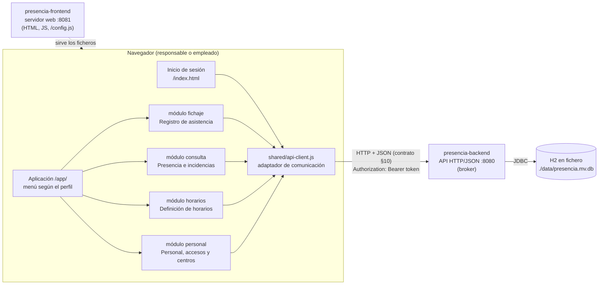

- **Una sola aplicación, dos perfiles.** Tras iniciar sesión, el menú muestra solo los módulos del
  perfil: el **empleado** ve *Mi fichaje* y *Mis registros*; el **responsable** ve *Registro de
  asistencia*, *Consulta de presencia*, *Definición de horarios* y *Personal y centros*.
- **Módulos frontend diferenciados.** Cada módulo vive en su carpeta (`web/modulos/<módulo>/`), exporta
  `{ id, roles, title, mount }` y solo recibe el adaptador de la API y el usuario. No comparten estado.
- **Los permisos los decide el backend**, no el menú: aunque un empleado llame a la API directamente,
  el backend responde `403 FORBIDDEN` si intenta ver o fichar datos de otra persona o usar una
  operación de responsable.
- **El frontend nunca accede a la base de datos**: solo usa `HttpPresenceApi`
  (`web/shared/api-client.js`), que es sustituible (otra URL, un doble de prueba...). Las vistas no hacen
  `fetch` ni conocen las rutas.
- **El backend no depende del frontend**: es ejecutable de forma independiente y solo expone JSON. Como
  la web se sirve desde otro puerto, responde a CORS (con `Authorization`, sin cookies).

## 5. Arquitectura del backend (hexagonal)

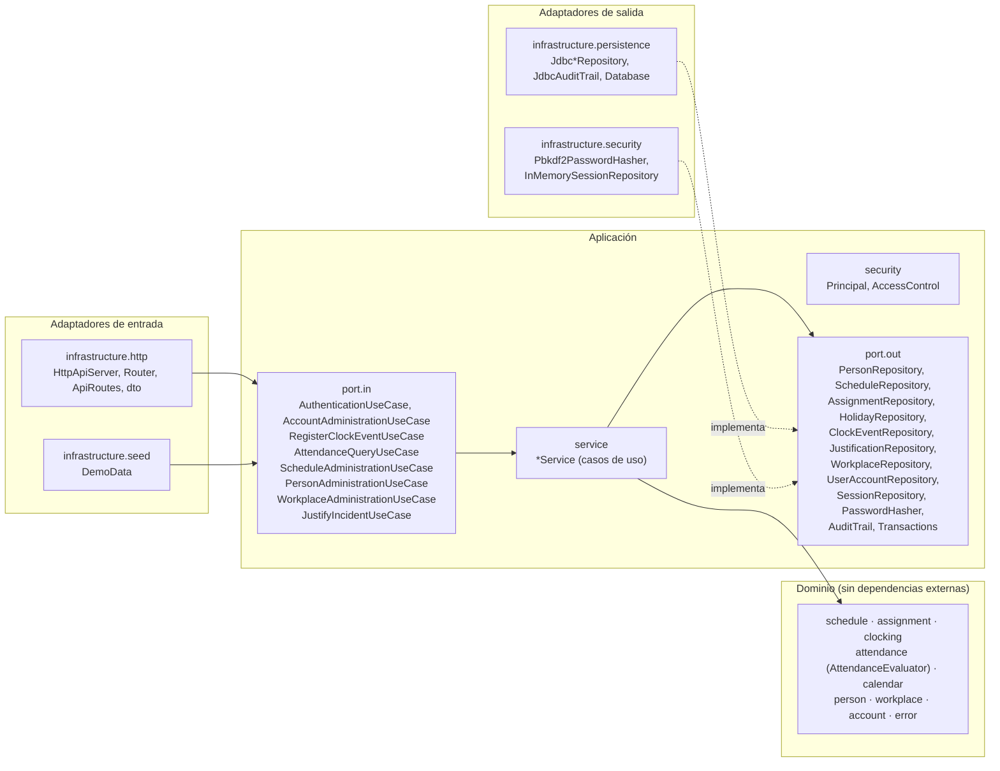

Reglas de dependencia (comprobadas por `ArchitectureTest`):

- `domain` solo usa el JDK: no importa nada de `application`, `infrastructure`, Jackson, H2, JDBC ni HTTP.
- `application` solo depende de `domain` y de sus propios puertos.
- Los adaptadores HTTP y de persistencia no se conocen entre sí.
- `Backend` es la **raíz de composición**: el único sitio que instancia implementaciones concretas.

Los casos de uso se han probado también con **adaptadores en memoria**
(`backend/src/test/.../support/InMemoryAdapters.java`), lo que demuestra que los puertos de salida son
sustituibles.

## 6. Estructura de la entrega y clases principales

```
control-presencia/
├── pom.xml                         POM padre (módulos backend y frontend; JDK 21)
├── mvnw, mvnw.cmd, .mvn/           Maven Wrapper (no hace falta instalar Maven)
├── .run/                           Configuraciones de ejecución de IntelliJ
├── backend/                        presencia-backend (API HTTP/JSON, arquitectura hexagonal)
│   └── src/main/java/software/ulpgc/presencia/
│       ├── BackendApplication.java Punto de entrada
│       ├── Backend.java            Raíz de composición
│       ├── domain/                 Modelo y reglas (sin dependencias)
│       ├── application/
│       │   ├── port/in/            Casos de uso (interfaces y comandos)
│       │   ├── port/out/           Puertos de salida
│       │   ├── security/           Principal (usuario autenticado) y AccessControl (permisos)
│       │   └── service/            Implementación de los casos de uso
│       └── infrastructure/
│           ├── http/               Adaptador HTTP (servidor, rutas con permisos, DTO, errores)
│           ├── persistence/        Adaptador JDBC/H2
│           ├── security/           PBKDF2 y sesiones
│           ├── json/               Representación JSON de horarios
│           ├── config/             AppConfig
│           └── seed/               Datos de ejemplo
├── frontend/                       presencia-frontend (aplicación web)
│   ├── src/main/java/.../FrontendServer.java   Servidor estático + /config.js
│   └── src/main/resources/web/
│       ├── index.html, login.js    Inicio de sesión / primer arranque
│       ├── app/                    Contenedor: menú por perfil y enrutado de módulos
│       ├── modulos/fichaje/        Registro de asistencia (empleado y responsable)
│       ├── modulos/consulta/       Consulta de presencia, informes, incidencias, auditoría
│       ├── modulos/horarios/       Definición de horarios, asignaciones y festivos
│       ├── modulos/personal/       Personas, accesos y centros de trabajo
│       └── shared/                 api-client.js, session.js, ui.js, styles.css
└── docs/                           capturas/ y e2e/recorrido.cjs (recorrido con navegador)
```

| Clase | Responsabilidad |
|---|---|
| `Schedule` (interfaz sellada) y `ContinuousSchedule`, `SplitSchedule`, `RotatingShiftSchedule`, `OnCallSchedule` | Cada tipo de horario y sus reglas: qué periodos de trabajo empiezan cada día |
| `ScheduleAssignment`, `ScheduleAssignments` | Asignación a persona o equipo en un periodo; la individual prevalece |
| `ClockEvent`, `ClockingPolicy`, `WorkSession` | Fichaje inmutable, coherencia de la secuencia y emparejado entrada-salida |
| `AttendanceEvaluator` | Servicio de dominio: incidencias, horas, desviación, estado diario y presencia actual |
| `RegisterClockEventService` | Caso de uso fichar (cerrojo por persona, validación, auditoría) |
| `AttendanceQueryService` | Presencia actual, informes, fichajes, incidencias y auditoría |
| `ScheduleAdministrationService` | Alta de horarios, asignaciones (sin solapes) y festivos |
| `IncidentJustificationService` | Justificación de incidencias (idea propia) |
| `HttpApiServer`, `Router`, `ApiRoutes` | Adaptador HTTP y traducción de errores de dominio a códigos HTTP |
| `Database`, `Jdbc*Repository`, `JdbcAuditTrail` | Persistencia JDBC con transacciones |
| `AuthenticationService`, `AccountAdministrationService` | Inicio de sesión (tokens con caducidad), primer responsable, cuentas y cambio de clave |
| `AccessControl`, `Principal` | Reglas de permisos: el empleado solo opera sobre sí mismo; el responsable, sobre todo |
| `Pbkdf2PasswordHasher` | Protección de claves (PBKDF2-HMAC-SHA256, sal aleatoria, comparación en tiempo constante) |
| `WorkplaceAdministrationService` | Centros de trabajo |
| `HttpPresenceApi` (JS) | Adaptador de comunicación sustituible de la aplicación web |
| `app.js` y `modulos/*` (JS) | Contenedor por perfil y módulos de fichaje, consulta, horarios y personal |

## 7. Modelo de datos

**Dominio**

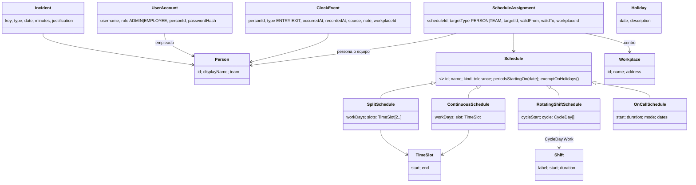

Las **incidencias se calculan** (no se guardan) a partir de fichajes, horario, festivos y la hora
actual; así nunca quedan desfasadas si se corrige un fichaje. Su clave estable
(`persona|fecha|tipo|hora`, p. ej. `EMP-002|2026-11-16|LATE_ARRIVAL|08:00`) permite guardar su justificación.

**Tablas** (`schema.sql`)

| Tabla | Contenido |
|---|---|
| `person` | id, display_name, team |
| `schedule` | id, name, kind, tolerance_minutes y `definition` (JSON con la estructura propia de cada tipo) |
| `schedule_assignment` | schedule_id, target_type (PERSON/TEAM), target_id, valid_from, valid_to, workplace_id |
| `holiday` | holiday_date, description |
| `clock_event` | person_id, event_type, occurred_at, recorded_at, source, note, workplace_id — **solo se inserta** |
| `workplace` | id, name, address (centros de trabajo) |
| `user_account` | username, role (ADMIN/EMPLOYEE), person_id, password_hash (PBKDF2), created_at |
| `incident_justification` | incident_key, person_id, reason, justified_by, justified_at |
| `audit_log` | logged_at, actor, action, entity_type, entity_id, detail — cada modificación |

Los instantes se guardan en UTC (`TIMESTAMP WITH TIME ZONE`) y se devuelven en la zona configurada.
Cada operación de escritura y su entrada de auditoría se guardan en la **misma transacción**.

## 8. Tipos de horario soportados

Cada tipo es una clase con reglas explícitas. El JSON mostrado es el cuerpo de `POST /api/schedules`.

### Corrido — oficina con jornada continua

Un único tramo los días laborables. En festivo no se trabaja.

```json
{ "name": "Oficina - jornada continua", "kind": "CONTINUOUS", "toleranceMinutes": 10,
  "workDays": ["MONDAY","TUESDAY","WEDNESDAY","THURSDAY","FRIDAY"],
  "slots": [ { "start": "08:00", "end": "15:00" } ] }
```

### Partido — restaurante con mañana y tarde

Dos o más tramos el mismo día **separados por una pausa** (se rechazan tramos contiguos o solapados).
Cada tramo se evalúa por separado: se puede llegar tarde al segundo o no volver tras la pausa.

```json
{ "name": "Restaurante - horario partido", "kind": "SPLIT", "toleranceMinutes": 5,
  "workDays": ["TUESDAY","WEDNESDAY","THURSDAY","FRIDAY","SATURDAY","SUNDAY"],
  "slots": [ { "start": "12:00", "end": "16:00" }, { "start": "19:30", "end": "23:30" } ] }
```

### Turnos rotatorios — hospital

Un ciclo de N días que se repite desde `cycleStart` (día del ciclo = (fecha − inicio) mod N). Un turno
puede **cruzar la medianoche** y pertenece al día en que empieza. Se rechaza un ciclo en el que un turno
se solape con el del día siguiente. Los festivos no anulan los turnos (cobertura continua).

```json
{ "name": "Hospital - turnos rotatorios", "kind": "ROTATING_SHIFT", "toleranceMinutes": 10,
  "cycleStart": "2026-11-16",
  "cycle": [ { "label": "Mañana", "start": "07:00", "durationMinutes": 480 },
             { "label": "Mañana", "start": "07:00", "durationMinutes": 480 },
             { "label": "Tarde",  "start": "15:00", "durationMinutes": 420 },
             { "label": "Tarde",  "start": "15:00", "durationMinutes": 420 },
             { "label": "Noche",  "start": "22:00", "durationMinutes": 600 },
             { "rest": true }, { "rest": true } ] }
```

### Guardias — hospital

Guardias en fechas concretas, hasta 24 h. Dos modalidades con reglas distintas:

- `PHYSICAL` (presencia física): se exige fichar; se evalúan ausencia, retraso y salida anticipada.
- `LOCALIZED` (localizada): no se exige presencia, no genera ausencias; si se acude, el tiempo fichado
  computa como trabajado (activación).

```json
{ "name": "Hospital - guardia de presencia física 24 h", "kind": "ON_CALL", "toleranceMinutes": 15,
  "start": "08:00", "durationMinutes": 1440, "mode": "PHYSICAL",
  "dates": ["2026-11-11", "2026-11-15", "2026-11-19"] }
```

## 9. Reglas de cómputo implementadas

Encapsuladas en `ClockingPolicy` (al fichar) y `AttendanceEvaluator` (al consultar):

**Al fichar**
1. La persona debe existir (`PERSON_NOT_FOUND`).
2. Entrada y salida se alternan: una segunda entrada sin salida es `DUPLICATE_CLOCK_EVENT`; una salida
   sin entrada abierta es `INCONSISTENT_CLOCK_EVENT`.
3. Los fichajes se añaden en orden cronológico (no se puede insertar uno anterior al último) y no
   pueden estar en el futuro.
4. Una **entrada** exige un horario vigente ese día: sin ninguna asignación → `SCHEDULE_NOT_ASSIGNED`;
   con asignaciones, pero ninguna cubre la fecha → `DATE_OUT_OF_PERIOD`. La salida no lo exige (cierra
   la entrada abierta, aunque sea de un turno de noche).
5. Se puede indicar la hora del fichaje (corrección de un olvido, origen `ADMIN`); queda guardada
   también la hora real de registro (`recordedAt`) y se audita.

**Al evaluar**
1. Los fichajes se emparejan en sesiones y cada sesión se asocia al periodo esperado con el que más se
   solapa (también del día anterior o siguiente, para turnos de noche y guardias). Una entrada hasta 2 h
   antes del inicio se asocia a ese periodo.
2. Sobre cada periodo ya iniciado, con la tolerancia del horario:
   - **Ausencia**: ninguna entrada pasada la tolerancia.
   - **Retraso**: primera entrada posterior a inicio + tolerancia.
   - **Salida anticipada**: última salida anterior a fin − tolerancia (solo cuando el periodo terminó).
   - **Salida pendiente**: entrada abierta pasado fin + tolerancia.
   - **Fuera de horario**: sesión que no corresponde a ningún periodo (informativo).
3. Las horas trabajadas solo cuentan sesiones **cerradas**; la desviación (trabajado − esperado) solo se
   calcula para días terminados.
4. Estado diario (el más grave): Ausente > Salida pendiente > Retraso > Salida anticipada > Justificado
   > En curso / Pendiente / Cumplido / Descanso / Festivo / Sin horario.
5. Asignaciones: la individual prevalece sobre la del equipo; las de un mismo destino no se solapan.

## 10. Contrato de comunicación

HTTP + JSON, prefijo `/api`, UTF-8. Las fechas son `AAAA-MM-DD`, las horas `HH:mm` y los instantes
ISO-8601 con desplazamiento (`2026-11-17T08:05:00Z`). Los `POST` exigen `Content-Type: application/json`
y se rechazan campos desconocidos.

**Autenticación.** `POST /api/auth/login` devuelve un token; el resto de peticiones lo envían en
`Authorization: Bearer <token>`. La sesión caduca a las 12 h (configurable) o con `logout`. La auditoría
guarda el usuario autenticado que hizo cada cambio.

**Permisos** (columna *Acceso*): **Público**; **Sesión** = cualquier usuario autenticado; **Propio** = un
empleado solo puede indicar su propia persona (si no la indica, se usa la suya) y el responsable
cualquiera; **Responsable** = solo perfil ADMIN.

| Método | Ruta | Acceso | Cuerpo / parámetros | Respuesta |
|---|---|---|---|---|
| GET | `/api/health` | Público | — | Estado, zona, hora y enumerados |
| GET | `/api/auth/status` | Público | — | `{"setupRequired": bool}` |
| POST | `/api/auth/setup` | Público (solo si no hay responsable) | `{"username","password"}` | 201 `Login` |
| POST | `/api/auth/login` | Público | `{"username","password"}` | `Login` = `{"token","expiresAt","user":{"username","role","personId","displayName"}}` |
| POST | `/api/auth/logout` | Sesión | — | 204 |
| GET | `/api/auth/me` | Sesión | — | `user` |
| GET | `/api/users` | Responsable | — | `[{"username","role","personId","createdAt"}]` (nunca la clave) |
| POST | `/api/users` | Responsable | `{"username","password","role":"ADMIN"\|"EMPLOYEE","personId"}` | 201 |
| POST | `/api/users/{username}/password` | Responsable | `{"password"}` | 204 (cierra sus sesiones) |
| GET / POST | `/api/people` | Responsable | `{"id":"EMP-009","displayName","team"?}` | `[Person]` / 201 |
| GET | `/api/workplaces` | Sesión | — | `[{"id","name","address"}]` |
| POST | `/api/workplaces` | Responsable | `{"id","name","address"?}` | 201 |
| GET | `/api/schedules`, `/api/schedules/{id}` | Sesión | — | `[Schedule]` / `Schedule` (§8) |
| POST | `/api/schedules` | Responsable | Uno de los cuerpos del §8 | 201 `Schedule` |
| GET | `/api/assignments` | Propio | `?personId=` | `[Assignment]` |
| POST | `/api/assignments` | Responsable | `{"scheduleId","personId" o "team","validFrom","validTo"?,"workplaceId"?}` | 201 |
| GET | `/api/holidays` | Sesión | — | `[{"date","description"}]` |
| POST | `/api/holidays` | Responsable | `{"date","description"}` | 201 |
| POST | `/api/clock-events` | Propio | `{"personId"?,"type":"ENTRY"\|"EXIT","source"?,"timestamp"?,"note"?}` | 201 `{"event","presence"}` |
| GET | `/api/clock-events` | Propio | `?personId=&from=&to=` | `[ClockEvent]` (con `workplaceId`) |
| GET | `/api/presence` | Responsable | — | `[Presence]` (con `workplace`) |
| GET | `/api/presence/{personId}` | Propio | — | `Presence` |
| GET | `/api/reports/daily` | Propio | `?personId=&from=&to=` (máx. 366 días) | `Report` con totales y días |
| GET | `/api/incidents` | Propio | `?personId=&from=&to=&type=` | `[Incident]` |
| POST | `/api/incidents/justifications` | Responsable | `{"incidentKey","reason"}` | 201 |
| GET | `/api/audit` | Responsable | `?limit=` (1–500) | `[AuditEntry]` |

Reglas del fichaje de un **empleado**: siempre sobre sí mismo, origen `WEB` (por defecto) o `KIOSK` y con
la hora del servidor; indicar `timestamp` u origen `ADMIN` devuelve `403`. El **responsable** puede fichar
para cualquier persona y con hora indicada (corrección de olvidos, origen `ADMIN`).

Ejemplo de fichaje y su respuesta:

```http
POST /api/clock-events
Content-Type: application/json
Authorization: Bearer 8Hc2…

{"type":"ENTRY"}
```

```json
{ "event": { "id": "59ce…", "personId": "EMP-001", "type": "ENTRY", "occurredAt": "2026-11-17T08:25:00Z",
             "recordedAt": "2026-11-17T08:25:00Z", "source": "WEB", "note": null, "workplaceId": "OFICINA" },
  "presence": { "personId": "EMP-001", "displayName": "Persona Oficina A", "status": "PRESENT", "inside": true,
                "since": "2026-11-17T08:25:00Z", "currentPeriod": "08:00-15:00",
                "currentPeriodStart": "2026-11-17T08:00:00Z", "currentPeriodEnd": "2026-11-17T15:00:00Z",
                "todayStatus": "LATE",
                "workplace": { "id": "OFICINA", "name": "Oficina central", "address": "Edificio A, planta 2" } } }
```

Un día del informe (`GET /api/reports/daily`) contiene `date`, `scheduleName`, `holiday`, `status`,
`expectedMinutes`, `workedMinutes`, `deviationMinutes` (null si el día no ha terminado), `openSession`,
`periods` (esperado y fichado de cada periodo) e `incidents`.

Estados de presencia (`status`): `PRESENT`, `PRESENT_OUT_OF_SCHEDULE`, `CHECKOUT_PENDING`, `ABSENT`,
`EXPECTED`, `ON_CALL`, `OFF_DUTY`, `NO_SCHEDULE`. Estados diarios: `NO_SCHEDULE`, `HOLIDAY`, `REST`,
`PENDING`, `IN_PROGRESS`, `COMPLETED`, `EXTRA_WORK`, `JUSTIFIED`, `EARLY_DEPARTURE`, `LATE`,
`CHECKOUT_PENDING`, `ABSENT`. Tipos de incidencia: `ABSENCE`, `LATE_ARRIVAL`, `EARLY_DEPARTURE`,
`MISSING_CHECKOUT`, `UNSCHEDULED_WORK`.

### Errores

Todos los errores tienen el mismo cuerpo:

```json
{ "error": "DUPLICATE_CLOCK_EVENT", "message": "Ya existe una entrada abierta desde 17/11/2026 08:25; registra antes la salida", "status": 409 }
```

| HTTP | `error` | Cuándo |
|---|---|---|
| 400 | `INVALID_DATA` | Datos incompletos o mal formados, JSON roto, campo desconocido, rango de fechas inválido, tramos incoherentes, clave de menos de 8 caracteres… |
| 401 | `UNAUTHENTICATED` | Sin token, token inventado, sesión caducada o cerrada |
| 401 | `INVALID_CREDENTIALS` | Usuario o clave incorrectos (mismo mensaje exista o no el usuario) |
| 403 | `FORBIDDEN` | Un empleado intenta ver o fichar datos de otra persona, indicar la hora o usar una operación de responsable |
| 404 | `PERSON_NOT_FOUND`, `SCHEDULE_NOT_FOUND`, `INCIDENT_NOT_FOUND`, `ACCOUNT_NOT_FOUND`, `WORKPLACE_NOT_FOUND`, `NOT_FOUND` | Recurso o ruta inexistente |
| 405 | `METHOD_NOT_ALLOWED` | Método no admitido en la ruta |
| 409 | `DUPLICATE_CLOCK_EVENT` | Entrada con otra entrada abierta |
| 409 | `INCONSISTENT_CLOCK_EVENT` | Salida sin entrada previa, o fichaje anterior al último |
| 409 | `PERSON_ALREADY_EXISTS`, `HOLIDAY_ALREADY_EXISTS`, `ASSIGNMENT_OVERLAP`, `INCIDENT_ALREADY_JUSTIFIED`, `ACCOUNT_ALREADY_EXISTS`, `WORKPLACE_ALREADY_EXISTS` | Conflictos de alta (una persona solo tiene una cuenta) |
| 409 | `SETUP_ALREADY_DONE` | Se intenta crear el primer responsable cuando ya existe |
| 413 | `PAYLOAD_TOO_LARGE` | Cuerpo de más de 64 KB |
| 415 | `UNSUPPORTED_MEDIA_TYPE` | `POST` sin `application/json` |
| 422 | `SCHEDULE_NOT_ASSIGNED` | La persona no tiene ningún horario asignado |
| 422 | `DATE_OUT_OF_PERIOD` | La fecha está fuera de los periodos de sus asignaciones |
| 500 | `INTERNAL_ERROR` | Error no controlado (sin detalles internos; se registra en el log) |

## 11. Ideas propias

**Perfiles de responsable y empleado en una misma aplicación.** Es la idea de partida del proyecto: un
mismo sitio en el que, según quién inicie sesión, se gestiona el personal o se ficha. Encaja con el
dominio porque el fichaje lo hace cada persona desde su móvil o un terminal, mientras que horarios,
correcciones e incidencias son de los responsables. Los permisos se aplican en el backend (el menú solo
es una ayuda) y las claves se guardan con PBKDF2; no hay credenciales en el repositorio.

**Centros de trabajo.** Cada asignación de horario indica en qué edificio o sede se cumple, y cada
fichaje guarda el centro de la asignación vigente (la salida, el de su entrada). La presencia actual
muestra dónde está cada persona.

**Incidencias justificadas.** Desde *Consulta → Incidencias* el responsable justifica una ausencia, un
retraso o una salida (cita médica, formación...). La justificación guarda motivo, autor y fecha, queda
auditada, no se puede repetir, y el día pasa a *Justificado* sin perder la incidencia original. Los
fichajes no se modifican (son de solo añadir), lo que mantiene la trazabilidad.

**Calendario de festivos con reglas por tipo de horario.** Un festivo anula los periodos de los horarios
corridos y partidos, pero **no** los turnos ni las guardias (cobertura continua del hospital): es una
regla explícita de cada tipo (`Schedule.exemptOnHolidays()`).

Además se audita toda modificación (*Consulta → Auditoría*) y el responsable puede corregir olvidos con
un fichaje de origen `ADMIN` y hora indicada.

## 12. Capturas

Tomadas con un navegador sobre el sistema real (backend y web arrancados, base de datos nueva con los datos de ejemplo)
por el recorrido automático `docs/e2e/recorrido.cjs`.

### Inicio de sesión

Primer arranque: se crea la cuenta de responsable (después, el formulario normal de inicio de sesión).

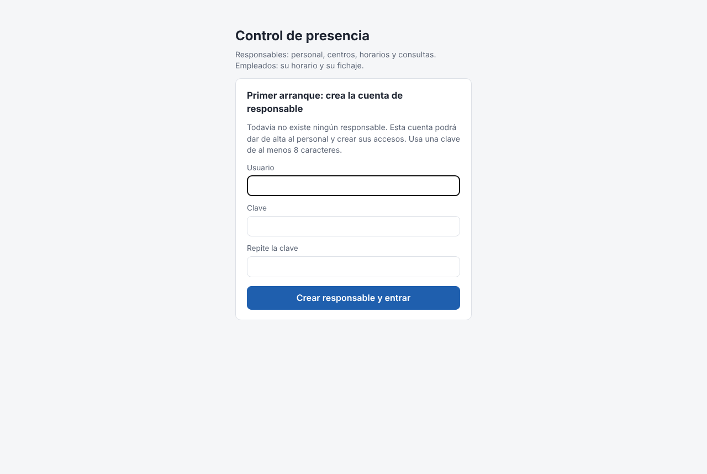

### Perfil empleado

*Mi fichaje*: estado actual con su centro, botones de entrada y salida, fichajes de hoy y su horario
(asignaciones y próximos 7 días). Solo ve sus datos.

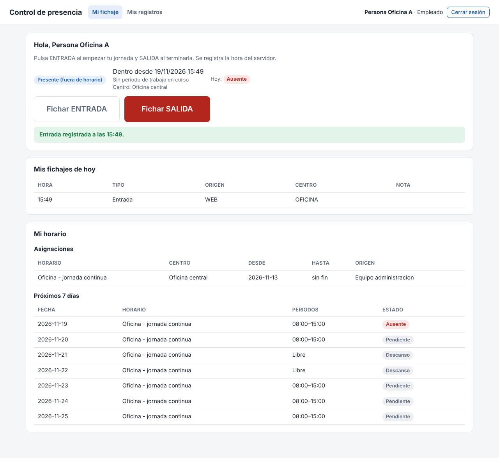

*Mis registros*: su informe por periodo, incidencias y fichajes.

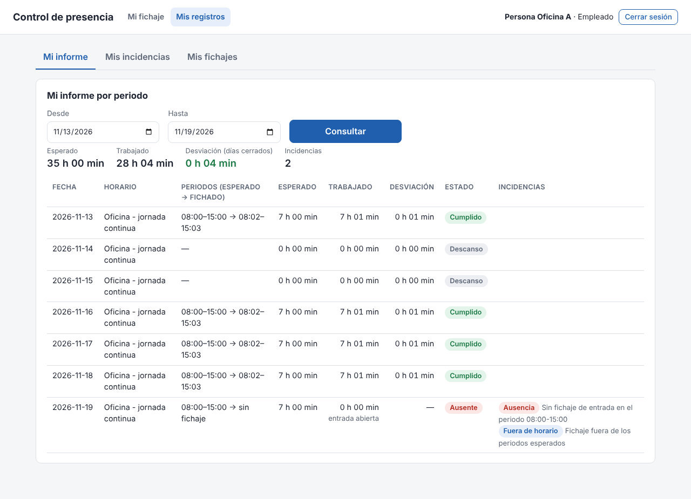

En el móvil (iPhone 13):

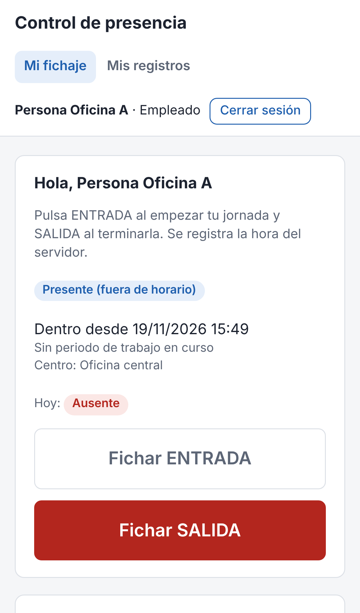

### Perfil responsable — Consulta de presencia

Presencia actual de todas las personas con su centro de trabajo.

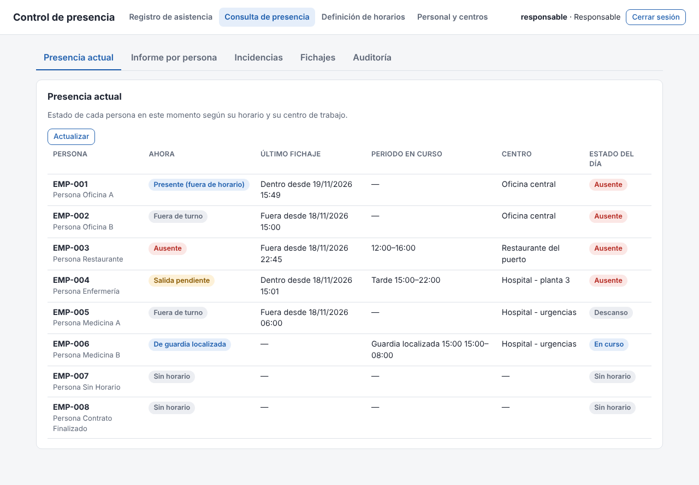

Informe por persona y periodo: esperado, trabajado, desviación e incidencias de cada día.

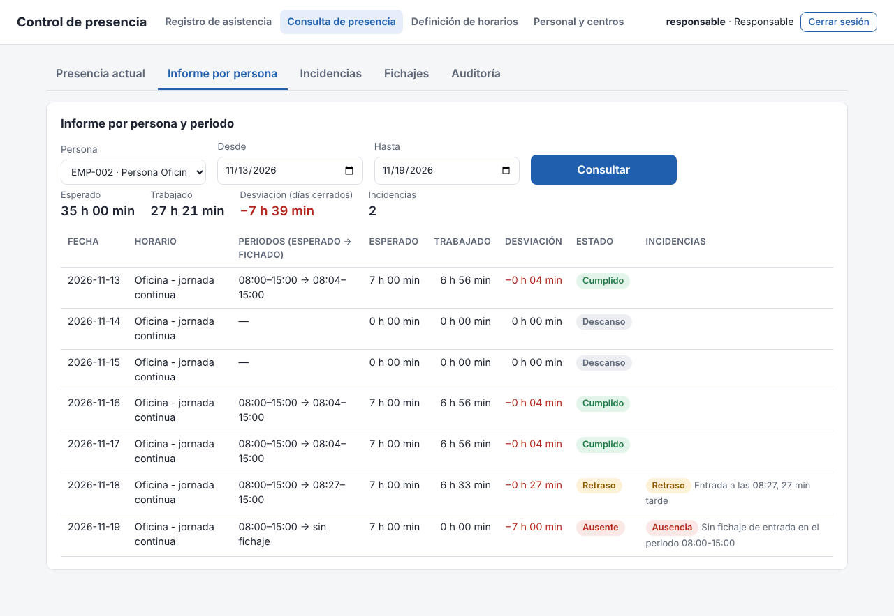

Incidencias, con una justificada desde la propia tabla.

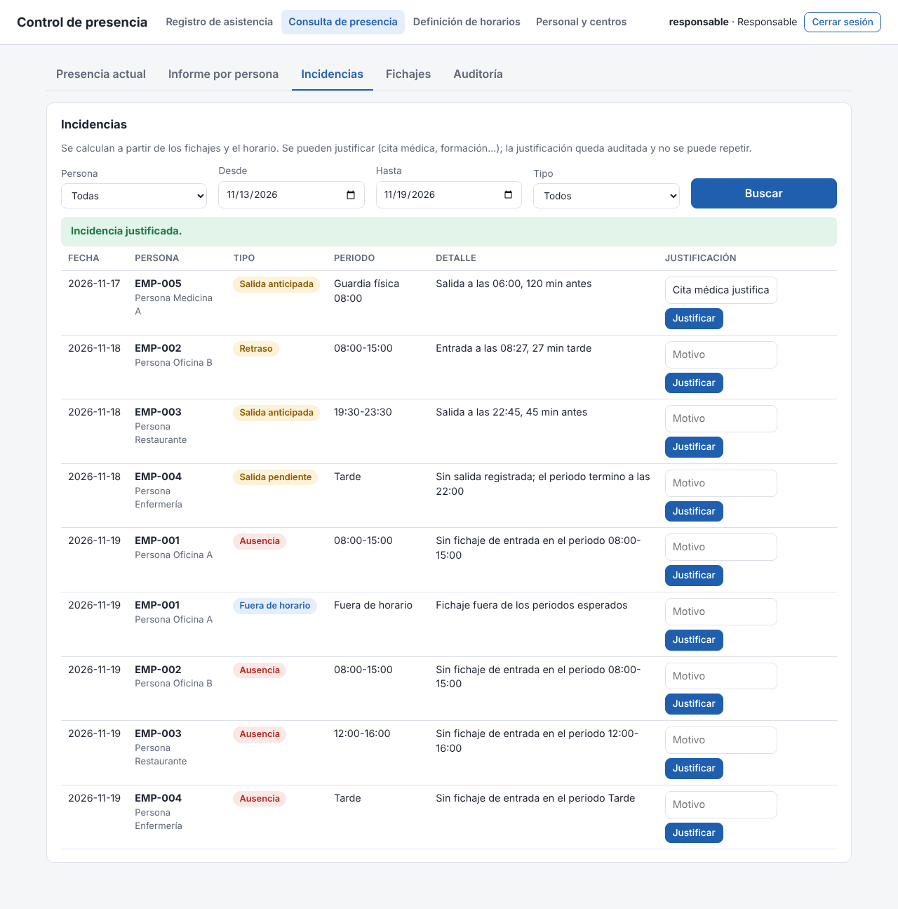

Auditoría: quién hizo cada cambio.


### Perfil responsable — Definición de horarios

Horarios de los cuatro tipos, formulario, asignaciones (persona o equipo y centro) y festivos.


Formulario de turnos rotatorios.


### Perfil responsable — Personal y registro de asistencia

Personas, accesos a la aplicación (con cambio de clave) y centros de trabajo.

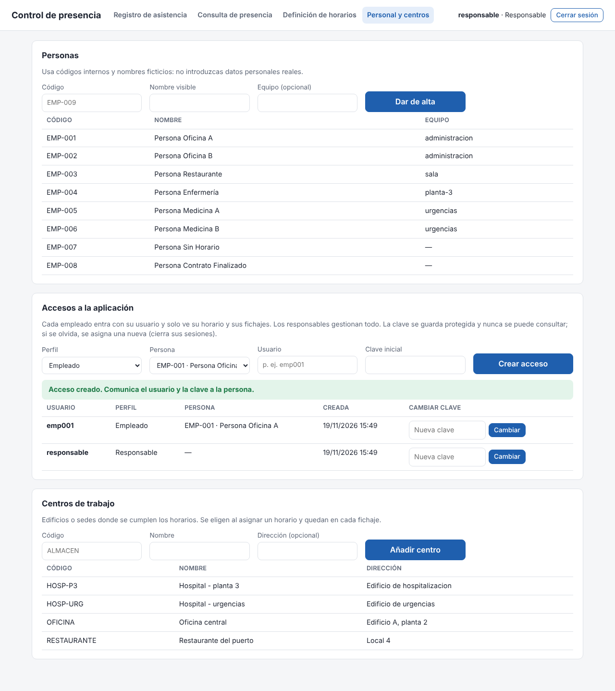

Fichaje en nombre de una persona sin horario: rechazado con `SCHEDULE_NOT_ASSIGNED`.

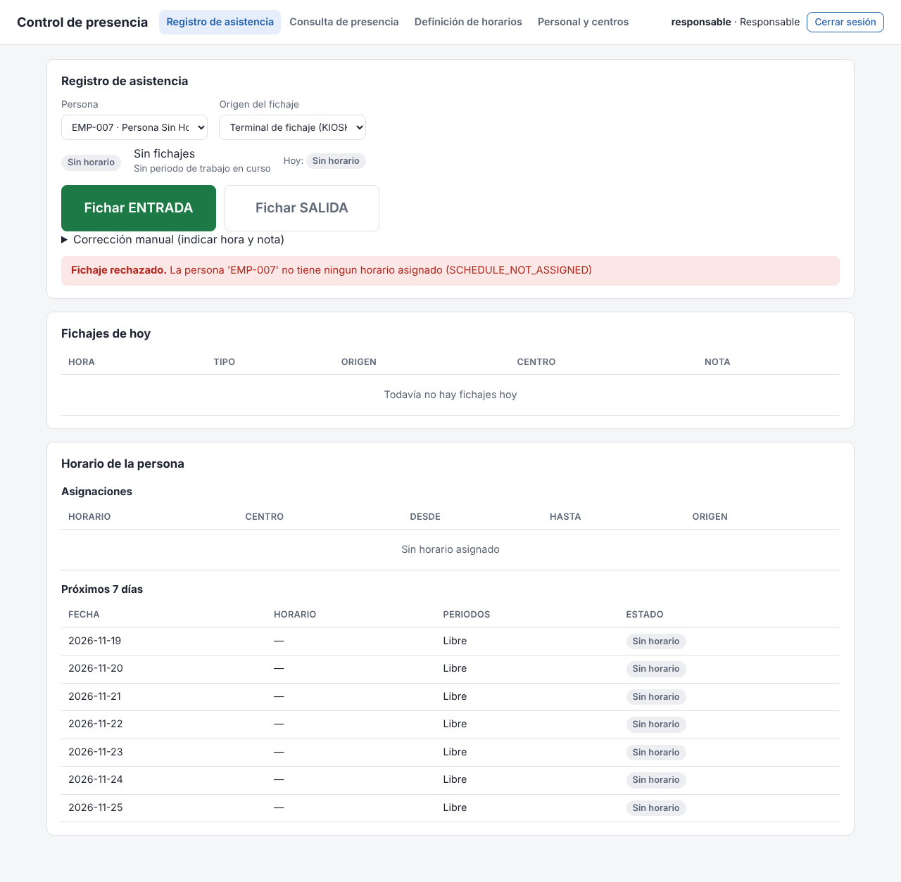

## 13. Verificación realizada

### Pruebas automatizadas (`mvnw test`: 61 pruebas, todas correctas)

| Clase de prueba | Qué verifica |
|---|---|
| `ScheduleTypesTest` (7) | Periodos de cada tipo de horario, ciclos antes de su inicio, validaciones (tramos sin pausa, solapes de turnos, tolerancia) |
| `ClockingPolicyTest` (4) | Entrada duplicada, salida sin entrada, orden cronológico y fichajes futuros |
| `AttendanceEvaluatorTest` (20) | Puntualidad, retraso, salida anticipada, ausencia, salida pendiente, festivos, trabajo extra, horario partido por tramos, turno de noche que cruza la medianoche, guardias física y localizada, justificaciones, estados de presencia |
| `UseCasesTest` (9) | Casos de uso con **adaptadores en memoria**: flujo completo, errores de fichaje, prioridad persona/equipo, solapes, festivos, justificación única y auditoría |
| `SecurityUseCasesTest` (5) | Primer responsable una sola vez, inicio de sesión, caducidad y cierre de sesión, cuentas (una por persona) y cambio de clave que cierra sesiones, reglas de `AccessControl` |
| `HttpApiIntegrationTest` (8) | Backend real (HTTP + H2): flujo de fichaje y consulta, **todos los códigos de error**, los 4 tipos de horario, **persistencia tras reiniciar**, datos iniciales, CORS, **401/403** y que un **empleado solo accede a sus datos** (y ficha con su centro) |
| `ArchitectureTest` (3) | Reglas de dependencia de la arquitectura hexagonal |
| `Pbkdf2PasswordHasherTest` (2) | Sal aleatoria, verificación y hashes mal formados |
| `FrontendServerTest` (3) | Se sirven el inicio de sesión, la aplicación y los cuatro módulos; `/config.js`; redirecciones y rutas no válidas |

### Recorrido automático con navegador (`docs/e2e/recorrido.cjs`)

Con el backend y la web arrancados sobre una base de datos nueva (sin carpeta `data/`) y Node.js +
Playwright:

```bash
node docs/e2e/recorrido.cjs docs/capturas
```

Comprueba, en un navegador real: creación del responsable y su menú de cuatro módulos; alta del acceso de
EMP-001 y rechazo de una clave corta; credencial errónea rechazada; menú del empleado (solo *Mi fichaje* y
*Mis registros*); fichaje de entrada y entrada duplicada rechazada; que el empleado no puede abrir el
módulo de horarios; presencia con centros, informe, justificación de una incidencia, auditoría; alta de
turnos rotatorios y rechazo de una guardia sin fechas; fichaje de una persona sin horario rechazado; y
que no hay errores de JavaScript. También se revisó la vista móvil (sin scroll horizontal).

### Comprobaciones manuales (sistema completo desde una copia limpia)

| Comprobación | Resultado |
|---|---|
| Compila y pasan las pruebas desde un `git clone` limpio | ✔ |
| El backend y la web arrancan con `java -jar` como procesos separados y se comunican | ✔ |
| Primer arranque: se pide crear el responsable; después ya no (`SETUP_ALREADY_DONE`) | ✔ |
| Se cargan los tres tipos de horario de ejemplo (más la guardia localizada) y cuatro centros | ✔ |
| Horarios asignados a personas ficticias (individual y por equipo) con centro | ✔ |
| Entrada y salida correctas como empleado | ✔ |
| Retraso, salida anticipada y salida pendiente en la consulta | ✔ |
| Consulta por persona y por periodo | ✔ |
| Persona inexistente / fichaje duplicado / salida sin entrada | ✔ 404 / 409 / 409 |
| Horario no asignado (EMP-007) / fecha fuera de periodo (EMP-008) | ✔ 422 / 422 |
| Empleado intentando ver o fichar a otra persona o usar rutas de responsable | ✔ 403 `FORBIDDEN` |
| Corrección de olvido con hora indicada como responsable | ✔ aceptada; `recordedAt` conserva la hora real |
| Reinicio del backend: fichajes, horarios, cuentas y auditoría persisten (hay que volver a iniciar sesión) | ✔ |

Para repetirlas a mano con `curl` (sustituye el token por el que devuelve el inicio de sesión):

```bash
curl -s -X POST localhost:8080/api/auth/login -H 'Content-Type: application/json' -d '{"username":"TU_USUARIO","password":"TU_CLAVE"}'
```

```bash
curl -s localhost:8080/api/presence/EMP-002 -H 'Authorization: Bearer TOKEN'
```

## 14. Límites conocidos

- **Seguridad**: inicio de sesión con usuario y clave (PBKDF2) y tokens aleatorios con caducidad, pero
  sin HTTPS (en local), sin límite de intentos fallidos ni recuperación de clave por correo (la clave la
  cambia un responsable). Las sesiones están en memoria: al reiniciar el backend hay que volver a entrar.
  El backend escucha por defecto solo en `localhost`; para usarlo desde móviles de la red habría que
  cambiar `presencia.http.host` y `presencia.frontend.host` y, en un despliegue real, poner HTTPS delante.
  CORS está abierto (`*`), lo que es aceptable porque la autenticación va en una cabecera y no en cookies.
- **Permisos**: dos perfiles fijos (responsable y empleado); no hay responsables limitados a un centro o
  a un equipo.
- **Concurrencia**: los fichajes de una persona se serializan con un cerrojo en memoria y las escrituras
  van en transacciones. Es correcto con **una sola instancia** del backend.
- **Reglas de cómputo**: una entrada abierta no suma horas hasta que se ficha la salida; no hay pausas
  dentro de un tramo, horas extra con compensación, convenios, bolsa de horas ni cómputo semanal/anual.
  Los tramos de horarios corridos y partidos no cruzan la medianoche (para eso están turnos y guardias).
  Las guardias tienen como máximo 24 h. Los festivos son comunes a todos los centros.
- **Incidencias**: se recalculan en cada consulta; si se cambian asignaciones pasadas, las incidencias
  de esos días cambian (los fichajes y las justificaciones no). Una justificación no se puede deshacer.
- **Modificación de datos**: no hay edición ni borrado de horarios, asignaciones, personas, centros o
  cuentas (solo altas y cambio de clave), ni anulación de fichajes más allá de añadir uno nuevo con hora
  indicada; un fichaje no puede ser anterior al último registrado.
- **Zona horaria**: una sola zona configurable para todos los centros. La aplicación calcula "hoy" con la
  fecha del navegador.
- **Escalabilidad**: las consultas evalúan en memoria (adecuado para cientos de personas, no miles con
  rangos largos); el rango de consulta está limitado a 366 días.
- **Datos**: todos los datos de ejemplo son ficticios. La base de datos se genera localmente en `data/`
  y está excluida del repositorio.
